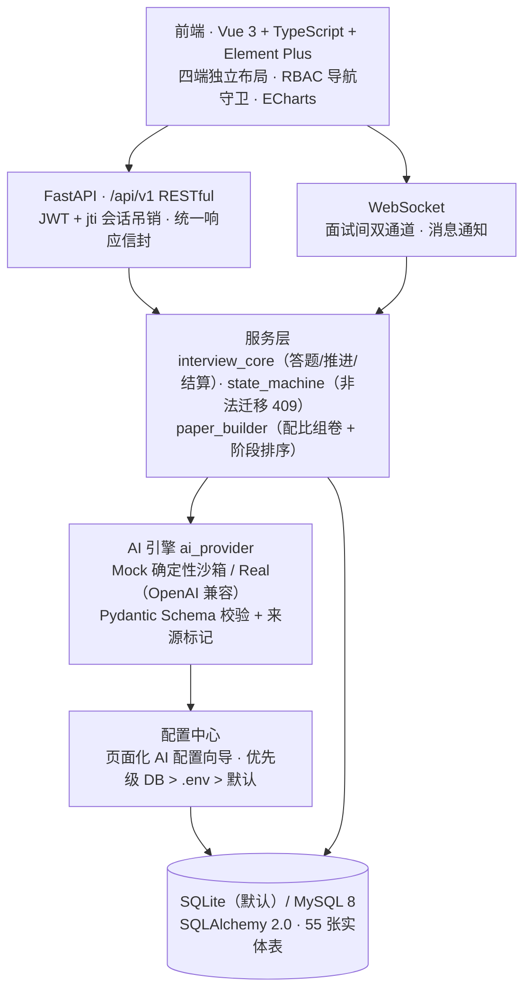

# 项目说明文档

**作品名称**：经纬职引-智面仓（AI Interview Hub）

**命题名称**：《智能面试仓的开发与应用》

**作品形态**：Web 全栈应用（四端一体：公共门户 / 个人求职者端 / 企业招聘端 / 平台治理后台）

**文档版本**：V1.1　|　**编制日期**：2026-10-14

> **提交前请先阅读「附录 D 匿名化核对清单」**：作品相关文件中不得出现参赛学校名称/标识与个人姓名，本文件正文已按该要求编写，但附带的截图与演示数据仍需核对。

---

## 一、项目概述

### 1.1 一句话介绍

智面仓把"模拟面试"从"刷题库"升级为**一次完整的、可量化的面试经历**：按岗位 JD 与个人简历动态组卷、逐题限时作答、答得好自动追问、结束前保留反问环节，交卷后输出六维能力雷达与逐题参考答案对照，并直接把薄弱项接到学习路线上。

同时向招聘侧延伸：企业可发布岗位、按匹配度筛选候选人、推进面试看板并提交结构化评估；平台侧提供资质审核、题库与 AI 引擎治理能力。

### 1.2 解决什么问题

| 求职者的问题 | 本作品的应对 |
|---|---|
| 背题库不等于会面试，缺乏"被追问"的压迫感 | 自适应追问：答得好插同技能更高难度题，答得差插更低难度题 |
| 不知道自己的回答差在哪 | 六维 Rubric 逐题评分 + 参考答案要点对照 + 用时与超时分析 |
| 练完就忘，短板没有被补齐 | 薄弱项自动汇入能力画像，并生成分阶段学习路线（含产出物与推荐资源） |
| 题目与岗位不匹配，"练了也没用" | 结构化题库按**岗位大类 + 技能 + 难度**三维组卷，专业题不跨岗位大类 |
| 企业的简历筛选与面试评价是黑箱 | 匹配度可解释、面试评价结构化、流程状态在看板上全透明 |

### 1.3 作品亮点速览

- **零配置开箱即用**：不配置任何模型密钥也能完整跑通全流程（内置确定性 Mock 引擎，离线可演示）；接入真实大模型只需在页面上填一次配置。
- **组卷不串岗位**：**321 道**结构化题库（专业 281 / 通用 20 / 压力 20）、**20** 个岗位大类、**88** 个技能，专业题严格限定在本岗位大类内——**已取消"关联大类借题"白名单**，题量缺口改由 AI 按 JD 定制生成，而不是塞别的岗位的旧题。
- **面试全流程闭环**：开场引导 → 逐题作答（限时/暂停/跳过/断点续面）→ 自适应追问 → 反问环节 → 交卷结算 → 报告 → 学习路线。
- **可靠性工程**：服务端权威计时、作答幂等、并发保护、报告失败可重试、非法状态一律 409。

---

## 二、命题理解与需求响应

命题要求建设一个"智能面试仓"，核心是把面试这件事数字化、智能化。本作品对命题的响应分为三层：

| 层次 | 响应内容 |
|---|---|
| **面试本身** | 结构化题库 + 智能组卷 + 实时问答 + 自动评分 + 诊断报告，构成可复用的一次完整面试 |
| **人岗协同** | 岗位 ↔ 简历 ↔ 能力的双向匹配：求职者看技能缺口，企业看候选人匹配度，平台沉淀能力数据 |
| **成长闭环** | 面试结果不止于分数，而是转化为能力画像与学习任务，形成"练—评—学—再练"的闭环 |

---

## 三、总体方案

### 3.1 四端架构

```
┌───────────────────────────────────────────────────────────────┐
│                          公共门户                              │
│  首页 · 职位广场 · 职位详情 · 企业主页 · 核心特性 · 关于 · 帮助    │
└───────────────────────────────────────────────────────────────┘
        │                    │                      │
┌───────────────┐   ┌───────────────┐   ┌───────────────────────┐
│ 个人求职者端   │   │  企业招聘端    │   │      平台治理后台      │
├───────────────┤   ├───────────────┤   ├───────────────────────┤
│ 工作台         │   │ 招聘工作台     │   │ 运营总览               │
│ 简历中心（双区）│   │ 岗位管理与发布 │   │ 用户 / 企业治理        │
│ 能力诊断       │   │ 候选人匹配     │   │ 资质与岗位审核         │
│ 模拟面试全流程 │   │ 面试看板流转   │   │ 投诉处置               │
│ 面试诊断报告   │   │ 结构化面试评价 │   │ 题库管理               │
│ 成长中心       │   │ 人才库         │   │ AI 引擎与调用日志      │
│ 学习路线       │   │ 数据分析       │   │ 安全审计               │
│ 求职计划       │   │ 企业设置/成员  │   │ 独立登录入口           │
└───────────────┘   └───────────────┘   └───────────────────────┘
```

四端各自独立布局与导航守卫，通过统一的 JWT + 角色（RBAC）体系隔离数据边界。

### 3.2 技术架构



**技术栈**

| 层 | 选型 |
|---|---|
| 前端 | Vue 3.5 · TypeScript（strict）· Vite · Pinia · Vue Router · Element Plus · ECharts |
| 后端 | FastAPI · SQLAlchemy 2.0 · Pydantic v2 · python-jose(JWT) · passlib/bcrypt · httpx · WebSocket |
| 数据 | SQLite（默认，单文件免部署）/ MySQL 8（生产可选，`DATABASE_URL` 切换）· Alembic 迁移 |
| AI | 自封装 `AIProvider`，OpenAI 兼容协议；Mock 与 Real 双引擎，自动降级并记录来源 |
| 交付 | Docker Compose（MySQL + Redis + Backend + Frontend）· Windows 一键启动脚本 |

---

## 四、核心功能实现

### 4.1 模拟面试全流程

```
创建面试 ──▶ 开场引导 ──▶ 逐题作答 ⇄ 自适应追问 ──▶ 反问环节 ──▶ 交卷结算 ──▶ 诊断报告 ──▶ 学习路线
（岗位/JD/简历/   （面试官问候 +    （限时·暂停·跳过·       （候选人提问，     （六维评分 +       （薄弱项
  模式/难度/题量）  须知 + 开始）     断点续面·幂等重提）       仅记录不计分）      逐题对照）        自动补齐）
```

**创建阶段**：选择岗位（自动带出 JD，可手改）、挂接简历、选择面试模式（综合/技术/行为）、难度与题量；**支持先预览考卷再开考**，预览顺序即实际出题顺序。

**作答阶段**：
- **服务端权威计时**：以"题目呈现时刻"为锚点计算真实单题用时，覆盖客户端上报值；超时轻扣分（每 30 秒扣 3 分、上限 15 分、不归零），暂停时长不计入。
- **自适应追问**：评分返回的 `next_action` 驱动——答得好追加同技能更高难度题，答得差追加更低难度或换题，每场上限 2 次，卷面实时记录。
- **可靠性**：作答携带题目标识与请求标识，同一请求重试返回已保存结果（幂等）；内容冲突或非法状态返回 409；支持中止归档、报告失败重试。
- **断点续面**：刷新页面后按服务端状态恢复当前题号、**已用时长**与草稿，不丢进度；整场不设硬性截止时间，答完由用户主动交卷。

**反问环节**（对齐真实面试流程）：逐题作答结束后进入反问环节，候选人可提问（最多 3 条）。该环节**只登记提问内容，不调用模型作答、不点评、不计入总分**——既保留了"面试官问'你有什么想问我的吗'"这一步流程完整性，也避免因"是否提问"反向惩罚内向型候选人。提问记录进入报告的"反问环节记录"区块。

**结算阶段**：六维 Rubric（专业基础/项目经验/系统设计/架构设计/沟通表达/算法思维）加权汇总，扣除超时与空答惩罚后给出总分与等级；生成逐题评分证据与参考答案要点对照；薄弱项写入能力画像并触发学习路线生成。

### 4.2 题库与组卷体系

**题库规模（实测）**

| 指标 | 数值 |
|---|---|
| 题目总数 | **321** 道（全部启用、全部已放行） |
| 题型构成 | 专业题 281 / 通用题 20 / 压力题 20 |
| 岗位大类 | **20** 个 |
| 技能维度 | **88** 个技能 |
| 灌库批次 | 6 个（`P0-CORE` 86 / `P0-NONTECH` 32 / `P0-3a` 60 / `P0-3b` 65 / `P0-3c` 54 / `P0-4` 24） |
| 每题结构 | 题干 · 参考答案要点（4~8 条）· 临场提示 · 阶段 · 难度 · 逐题限时 · 技能别名 |

**组卷规则**（这是"题目贴切度"的关键）

1. **相关性下限**：专业题只允许两级候选——本岗位大类且技能命中 → 本岗位大类未命中技能。**取消跨岗位大类兜底**，题量不足的部分改由 AI 按 JD + 简历定制生成，而不是用别的岗位的旧题填补。
2. **零跨类**：早期版本对技能确实重叠的大类（如全栈研发 ↔ 后端开发/前端开发）登记过"关联大类白名单"允许借题，该白名单**已删除**——借来的题对候选人没有练习价值，宁可交给 AI 按 JD 现生成。当前专业题候选只有本岗位大类一级，并由回归用例断言白名单不复存在。
3. **技能别名匹配**：题库支持技能别名（如"消息队列"命中 `Kafka`），降低因命名差异导致的漏匹配。
4. **阶段有序组卷**：整卷不再全局随机，按真实面试节奏排布——综合素养 → 专业基础 → 深度探究 → 项目深挖 → 系统设计 → 压力应对，同阶段内随机。AI 补足的题也会参与统一排序，不会堆在卷尾。
5. **难度锚定**：用户未显式选择难度时，按岗位经验要求推导基准难度。

**题库治理**：题目带审核态（`APPROVED` / `PENDING` / `REJECTED`）与**灌库批次**标记，**组卷只取已放行题**，避免未经审核的题目污染卷面；新批次默认待审，管理后台支持**按批次或岗位大类批量放行/驳回/退回待审**与单题三态操作；灌库脚本以题干为幂等键，**只更新元信息、不覆盖管理端已做出的审核结论**；卷面 JSON 快照固化题型配比、抽题来源与缺口补足情况，历史可复现。

### 4.3 简历与能力诊断

- **简历中心双区管理**：上传的 PDF/DOCX 进入"原文档库"（列表 + 内嵌预览），一键 AI 解析生成**独立的**在线简历，不污染手工编辑内容；在线简历支持结构化编辑、AI 诊断与一键优化。
- **解析提速**：针对 qwen3 系列关闭思考模式（`enable_thinking:false`），整篇简历解析耗时从约 90 秒降至约 10 秒。
- **诚实性约束**：解析 prompt 显式约束输出结构，模拟或解析结果一律不写入虚构经历、不虚构学历与项目业绩。
- **能力画像**：每次面试的评分按技能聚合，写入能力历史与雷达图；字节跳动式"达标线"对照帮助定位差距。

### 4.4 求职计划与官网投递

- **求职计划工作台**：收集外部岗位或从平台岗位加入计划，按本人简历分析技能覆盖与缺口，整理求职信、跟进草稿与 STAR 面试素材，记录进度、截止日期与跟进提醒。
- **来源标记**：分析与准备包使用确定性规则 + 本人简历已有素材，来源标记为 `RULE`，不谎称模型生成或企业验证。
- **官网投递**：岗位提供企业官网入口；实际投递由用户在官网完成，本系统记录访问与用户确认的投递状态。

### 4.5 企业招聘端

AI 解析 JD 一键发布 → 平台审核上架 → 候选人按匹配度排序 → 简历快照与能力档案 → 面试看板流转 → 结构化面试评价 → 人才库沉淀 → 招聘数据分析。企业侧可见的所有候选信息均来自投递时保存的快照，不做推断与虚构。

### 4.6 平台治理后台

用户与企业治理、资质与岗位审核、投诉处置、题库管理、AI 引擎配置与脱敏调用日志、安全审计。管理员可独立入口登录，与业务端隔离。

---

## 五、关键技术实现

### 5.1 双引擎 AI 架构（离线可演示）

`AIProvider` 统一封装 9 类任务（简历解析 / 简历优化 / 简历改写 / JD 解析 / 出题 / 六维评分 / 报告生成 / 学习路线 / 匹配解读），每类任务：

- 绑定 **Pydantic Schema** 校验模型输出，结构不合格即判定失败；
- 记录**实际来源**（`REAL` / `MOCK` / `RULE` / `UNKNOWN`）并落到卷面快照与报告，便于审计；
- 无密钥或调用失败时**自动降级**到确定性 Mock，保证演示不中断；
- 正式企业面试**拒绝模拟评分与模拟报告**（必须真实模型），避免"看起来能跑实际是假"。

配置优先级为 **DB > .env > 默认**，管理员可在页面完成 Key / Base URL / 模型配置与连接测试，保存即生效。

### 5.2 会话状态机与双通道统一

- 状态集中声明：`CREATED → READY → IN_PROGRESS ⇄ PAUSED → COMPLETED / CANCELLED / EXPIRED`，终态拒绝一切操作。
- **REST 与 WebSocket 共用同一套 `interview_core`**，避免两条通道各写一份逻辑而产生分叉（历史上曾出现 WS 重复创建评分、能力项写死等分叉问题）。
- 面试环节用独立字段标记（开场 / 逐题 / 反问 / 已结算），**只做环节标识，不影响状态机**，因此不扰动既有的暂停、恢复、中止、超时逻辑。

### 5.3 可靠性设计

| 机制 | 说明 |
|---|---|
| 幂等作答 | 携带请求标识，同一请求重试返回已保存结果，不重复评分 |
| 并发保护 | 评分处理带租约（CAS），两个并发提交只有一个成为评分所有者 |
| 服务端计时 | 用时以服务端锚点为准，客户端上报仅作无锚点时的回退 |
| 报告失败可重试 | 评分与报告解耦，报告生成失败保留已提交作答，稍后重试不重复评分 |
| 反问幂等 | 反问记录带唯一索引（`interview_id + seq` 与 `interview_id + request_id`），防并发与超时重发重复落库 |
| 私有文件授权 | 上传文件按所属授权下载，不暴露可枚举路径 |
| 会话吊销 | JWT 携带 `jti`，支持强制下线；修改密码撤销旧会话 |

### 5.4 语音链路（零云端成本）

浏览器原生 Web Speech API 做口述转写，`speechSynthesis` 做题目朗读，不接入任何云端 ASR 服务（不引入密钥与配额依赖）。设备检测真实化（摄像头/麦克风数量、TTS 能力、后端往返实测）。识别失败时给出分级诊断：本地音量计实时显示，8 秒无结果时按音量峰值区分"麦克风正常但识别服务无返回（网络问题）"与"本地音量过低（设备问题）"。

---

## 六、数据规模（实测）

| 指标 | 数值 | 说明 |
|---|---|---|
| 题库 | **321** 题 | 专业 281 / 通用 20 / 压力 20，全部已审核放行 |
| 岗位大类 / 技能 | **20** / **88** | 每个技能均具备 EASY/MEDIUM/HARD 三档题 |
| 数据库实体表 | 55 张 | 覆盖用户、企业、岗位、简历、面试、评分、能力、学习、治理 |
| 演示数据 | 23 用户 / 20 岗位 / 27 场面试 | 用于演示与验证 |

> 说明：上述用户与面试记录为项目内置演示数据，用于功能演示与验证，不代表真实用户规模。

---

## 七、安全与合规

- **认证与会话**：JWT + `jti` 有效会话校验，支持强制下线；找回密码要求可用 SMTP，不返回开发重置令牌。
- **权限隔离**：四端角色隔离（SEC-01~07），越权返回 403；企业侧严禁访问个人训练与私密数据；超管保护。
- **数据诚实性**：所有统计使用真实记录，无依据时显示"未知"或空态；**模拟评分不写入正式技能证据**（来源非真实时不计入能力画像）。
- **隐私**：私有文件按授权下载；AI 调用日志脱敏；密码绝不落本地存储。
- **合规边界**：不虚构候选人经历、不虚构企业背景、不宣称"录用概率"。

---

## 八、测试与验证

| 维度 | 命令 / 方式 | 结果 |
|---|---|---|
| 后端回归测试 | `pytest tests -q`（隔离数据库副本 + 模拟 AI） | **76 项通过 / 0 失败**；覆盖幂等与并发、超时轻扣、题库批次闸门与零跨类、反问不计分且不触达模型、僵尸会话清扫三态 |
| 端到端冒烟 | `scripts/test_question_bank.py` / `test_overtime.py` / `test_admin_bank_and_insights.py` | **60 / 32 / 46 全过**（组卷配比 → 全流程 → 反问 → 报告；服务端计时与超时；题库审核、批次放行、历史对比与薄弱题重练） |
| 前端类型检查与构建 | `npm run build`（`vue-tsc -b` + vite build） | **通过**（仅包体积提示） |
| 数据库迁移 | Alembic `0011`/`0012`/`0013` 升级 → 降级 → 再升级（开发库副本演练） | 通过，既有数据无损；随后已在开发库就地执行至 `0013` |
| 组卷贴切度 | 逐岗位大类开 10 题综合卷 | 专业题 **100% 属本岗位大类**，无跨类陈题（V1.0 按 19 类实测；题库扩至 20 类后建议按附录 A 命令复核） |
| 浏览器实测（此前版本） | 桌面端与 390px 手机布局、求职计划与官网投递流程走查 | 通过 |
| **本轮未覆盖项（如实说明）** | 面试间（正计时、暂停冻结、反问即时回显）与题库管理页（批次放行、筛选联动） | **仅静态验证**：类型检查 + 生产构建 + 后端与冒烟脚本断言；**浏览器运行时走查尚未执行**，不标注为已验收 |

**代码质量约定**：所有新增逻辑带类型标注、错误处理、超时与日志；LLM 调用集中封装于 `ai_provider`，测试一律使用 Mock，不真实调用付费 API。

---

## 九、创新点

1. **"贴切度"作为组卷第一约束**：把"题目不跨岗位"从经验判断变成可验证的硬规则——专业题候选只有本岗位大类一级，逐大类开卷实测专业题 100% 同岗位大类；曾存在的"关联大类借题白名单"已彻底删除（回归用例断言其不复存在），缺口交给 AI 按 JD 现生成，并用技能别名匹配降低命名差异导致的漏配。
2. **面试流程完整性对齐真人面试**：补齐容易被忽略的**开场引导**与**反问环节**两个环节；反问只记录提问——**不计分、不占时、不调用模型**，兼顾流程真实、心理安全与运行成本，提问清单还能原样带到真实面试现场。
3. **可解释的 AI 来源体系**：每道题、每次评分、每份报告都记录实际来源（真实/模拟/规则）并展示给用户，同时严格限制模拟结果写入能力画像——把"AI 生成"从黑箱变成可审计链路。
4. **零密钥可演示的双引擎**：Mock 引擎为确定性实现（非随机文案），同一输入可复现同一输出，使演示与回归测试都稳定。
5. **服务端权威的面试可靠性**：计时锚点、作答与反问幂等、并发租约、报告失败重试、非法状态 409，加上后台清扫任务对"关页面遗留场次"的兜底收尾，共同构成"刷新不丢、重发不重、失败可续、悬挂有人收"的体验基线。

---

## 十、应用价值

- **对求职者**：把"刷题"变成"练面试"，且练完能拿到可执行的改进方向与学习清单。
- **对高校就业指导**：可批量开展模拟面试训练与能力摸底，输出结构化的能力画像与短板分布。
- **对中小企业招聘**：无需自建 AI 能力即可获得岗位结构化、筛选可解释、评价标准化的招聘流程。
- **对社会化培训与职教机构**：模拟面试与学习路线可直接复用为教学工具与效果评估工具。

---

## 十一、已知限制与后续规划

**已明确的限制（设计取舍，非遗漏）**

- 定位为竞赛/演示作品：登录验证码、接口限流、AI 异步任务队列、病毒扫描等"防御当前并不存在的威胁"的能力被明确划为范围外，理由与兜底方案见 `docs/功能完善与实现建议.md`。
- SQLite 单文件适合个人/演示规模；多实例水平扩展需切换 MySQL。
- 语音识别由浏览器厂商云端完成（Chrome→Google、Edge→微软），**需网络可达对应服务**，不可达时页面给出分级诊断提示；未接入云端 ASR 属刻意选择（避免密钥与配额依赖）。
- MySQL 与真实模型服务需在实际部署环境进一步验证。
- 通知广播仍在单进程内，多实例部署需引入共享消息通道。
- **模拟面试不设硬性截止时间**（对齐真实答题节奏），代价是"答完直接关页面"不会立刻出报告：这类场次由后台清扫任务按最后活动时间判定，连续静默超阈值（默认 24 小时）后兜底收尾——有作答则结算出报告，无作答则取消。多实例部署时各进程都会尝试清扫，结算有租约保护，不会写坏数据，但需要引入任务互斥以避免重复尝试。
- **题库批次已一次性放行**：321 题当前全部 `APPROVED`，即审核闸门的**机制**已验证可用，但这批扩充题目**未经逐题人工审读**；管理端支持随时按批次驳回或退回待审（`seed_question_bank.py --requeue` 可重新送审）。
- **前端本轮改动未做浏览器运行时走查**：面试间（正计时、反问纯记录）与题库管理页（批次放行、筛选联动）目前只有类型检查、生产构建与后端/冒烟脚本断言作为证据，见「八、测试与验证」的未覆盖项说明。

**后续规划方向**

| 方向 | 内容 |
|---|---|
| 题库治理 | 扩充长尾岗位大类题量、补齐历史题目的技能别名覆盖、完善管理端覆盖度看板与逐题人工抽检流程 |
| 面试体验 | **反问提示卡**（每大类 3~5 条高质量提问方向，纯静态数据、零模型成本）弥补"AI 不作答"后的引导空白；评分结果流式呈现 |
| 工程化 | 清扫任务的多实例互斥（分布式锁或独立 worker 进程）、评测集与效果回归、真实模型下的提示词版本管理 |
| 其它 | 多语言面试、无障碍适配 |

---

## 附录 A　运行方式

**Windows 一键启动**：双击 `一键打开.bat`（自动检查依赖、启动前后端、就绪后打开浏览器）；`一键关闭.bat` 停止服务。日志在 `logs/`。

**手动启动**

```powershell
# 后端（端口 8000，含热重载）
cd backend && ..\.venv\Scripts\python.exe -m uvicorn main:app --host 127.0.0.1 --port 8000 --reload

# 前端（新终端；Vite 已代理 /api、/ws、/uploads → 8000）
cd frontend && npm run dev
```

- 前端：http://localhost:5173　·　接口文档：http://127.0.0.1:8000/docs
- 首次演示数据：`cd backend && ..\.venv\Scripts\python.exe scripts\seed_demo.py`
- **不配置任何模型密钥也能完整体验**（内置确定性 Mock 引擎）
- 环境变量均可选，见 `.env.example`；`AI_MODE`（REAL/MOCK）、`DATABASE_URL`、`SECRET_KEY`（生产必改）、`INTERVIEW_ZOMBIE_IDLE_HOURS`（默认 24）、`INTERVIEW_SWEEP_INTERVAL_SECONDS`（默认 600）

**题库三步（新环境首次部署必做）**

```bat
:: 1) 迁移到最新版本（启动后端也会自动执行）
cd backend && ..\.venv\Scripts\python.exe -m alembic upgrade head
:: 2) 灌入结构化题库（幂等，不覆盖管理端已做出的审核结论）
cd backend && ..\.venv\Scripts\python.exe scripts\seed_question_bank.py
:: 3) 放行批次：管理端「结构化题库管理 → 按批次审核」逐批放行，
::    或命令行一次性放行指定批次（等价操作）
cd backend && ..\.venv\Scripts\python.exe -c "from app.core.database import SessionLocal; from scripts.seed_question_bank import release_batches; db=SessionLocal(); print('released', release_batches(db)); db.close()"
```

**文中数字的复核命令**（题量、题型、大类、技能、迁移版本）

```bat
cd backend && ..\.venv\Scripts\python.exe -c "import sqlite3;c=sqlite3.connect('zhimeicang.db');print('version',c.execute('select version_num from alembic_version').fetchone()[0]);print('total',c.execute('select count(*) from question_bank').fetchone()[0]);print('by_type',c.execute('select question_type,count(*) from question_bank group by 1').fetchall());print('categories',c.execute('select count(distinct job_category) from question_bank').fetchone()[0]);print('skills',c.execute('select count(distinct skill_name) from question_bank').fetchone()[0]);print('review',c.execute('select review_status,count(*) from question_bank group by 1').fetchall())"
```

## 附录 B　演示账号

| 角色 | 账号 | 说明 |
|---|---|---|
| 个人求职者 | `student@example.com` | 含简历、面试记录、能力雷达与学习任务 |
| 企业创建人 | `owner@example.com` | 企业超级管理员，全权限 |
| 企业招聘负责人 | `hr@example.com` | 发布岗位、推进看板、发送面试邀约 |
| 企业业务面试官 | `interviewer@example.com` | 查阅候选人档案、提交结构化评估 |
| 平台系统管理员 | `admin@example.com` | 独立入口 `/admin/login` |

密码统一为 `123456`。（**注**：演示账号为内置仿真数据，演示前请确认其页面内容满足匿名化要求，见附录 D。）

## 附录 C　工程目录

```
ai-interview-hub/
├── backend/
│   ├── app/
│   │   ├── api/v1/          # 路由层（认证、岗位、简历、面试、企业、管理）
│   │   ├── services/        # 服务层（interview_core 答题推进结算、paper_builder 组卷、
│   │   │                    #         state_machine 状态机、learning 学习路线、matching 匹配）
│   │   ├── ai/              # AI 引擎（provider 双引擎、schemas 输出校验、mock_data）
│   │   ├── models/          # SQLAlchemy 实体
│   │   ├── schemas/         # Pydantic 输入输出契约
│   │   ├── data/            # 结构化题库种子
│   │   └── websocket/       # 面试间与通知双通道
│   ├── alembic/versions/    # 数据库迁移
│   ├── scripts/            # 灌库、演示数据、端到端冒烟脚本
│   └── tests/              # 回归测试（隔离临时库）
├── frontend/src/
│   ├── views/              # public / auth / personal / enterprise / admin
│   ├── layouts/            # 四端独立布局
│   ├── components/         # 雷达图、趋势图、统一状态容器
│   ├── api/  stores/  router/  types/
├── docs/                   # 项目文档
├── docker-compose.yml
└── 一键打开.bat / 一键关闭.bat
```

## 附录 D　匿名化核对清单（提交前必读）

命题明确要求：**视频、PPT、报告书、说明文档等作品相关文件中，不得出现参赛学校名称/标识与个人姓名**（团队分工部分可出现姓名，但不得出现学校）。

本文件正文已按此要求编写。以下**外部材料仍需逐一核对**：

| 序号 | 需核对对象 | 风险点 | 处理建议 |
|---|---|---|---|
| 1 | 项目截图（`docs/screenshots/`、`docs/ui-audit/`） | 简历/档案/演示数据页面可能展示就读院校 | 逐张查看；必要时改用不含院校信息的页面或做局部遮挡后重新截图 |
| 2 | 演示数据（`seed_demo.py`） | 内置示范简历含院校名称与候选人姓名 | 录屏与截图前先确认画面内容；或改用匿名化后的演示数据 |
| 3 | 代码与界面中的文案 | 品牌名在不同位置表述不统一 | 统一为作品正式名称（见下文"待确认事项"） |
| 4 | 本仓库开发文档（如审计报告） | 部分开发文档含开发环境路径等非投稿信息 | 不随作品提交，或提交前单独整理 |
| 5 | 视频与报告书 | 出现解说人姓名、学校标识、片头 Logo | 按命题要求统一处理 |

---

## 附录 E　文档修订记录

| 版本 | 日期 | 说明 |
|---|---|---|
| V1.0 | 2026-10-14 | 首版；基于仓库实测数据编制（题量、测试基线、构建状态均经脚本复核） |
| V1.1 | 2026-10-14 | 同步模拟面试改造：题库 321 题 / 20 大类 / 88 技能与批次审核放行；反问环节改为**纯记录**（不计分、不占时、不调用模型）；整场由倒计时改为正计时、不设硬性截止并新增僵尸会话清扫兜底；迁移链至 `0013`；删除已废弃的"关联大类借题白名单"与"归零自动交卷"表述；测试表补冒烟与迁移证据，并**如实标注本轮前端改动未做浏览器运行时走查** |
